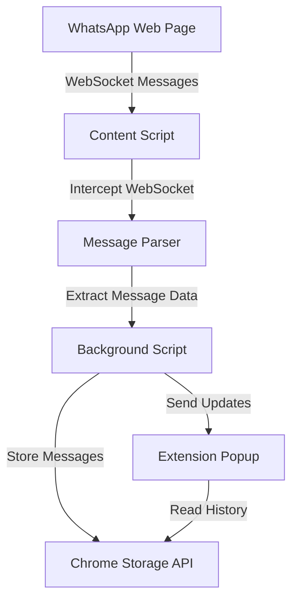

> Historical design notes. See README.md and TESTING.md for the current product behavior.

---
name: WhatsApp Message Interception Extension
overview: Create a Chrome extension that intercepts incoming WhatsApp Web messages via WebSocket hooking and stores them locally for history tracking.
todos:
  - id: setup-manifest
    content: Create manifest.json with required permissions (host permissions for web.whatsapp.com, storage, activeTab) and define content script injection
    status: pending
  - id: content-script-websocket
    content: Implement content script to hook WebSocket API and intercept incoming messages from WhatsApp Web
    status: pending
    dependencies:
      - setup-manifest
  - id: dom-fallback
    content: Implement DOM-based message detection using MutationObserver as fallback/primary method for message interception
    status: pending
    dependencies:
      - setup-manifest
  - id: message-parser
    content: Create message parsing logic to extract sender, content, timestamp, and chat ID from intercepted messages
    status: pending
    dependencies:
      - content-script-websocket
      - dom-fallback
  - id: background-storage
    content: Implement background service worker to receive messages from content script and store them using chrome.storage.local API
    status: pending
    dependencies:
      - setup-manifest
  - id: storage-utils
    content: Create storage utility functions for message storage, retrieval, indexing, and quota management
    status: pending
    dependencies:
      - background-storage
  - id: popup-ui
    content: Build popup interface (HTML/CSS/JS) to display stored message history with filtering and date grouping
    status: pending
    dependencies:
      - storage-utils
  - id: testing
    content: Test extension with various message types, handle edge cases, and optimize performance
    status: pending
    dependencies:
      - popup-ui
      - message-parser
---

# WAiDrop - Message Interception Extension

## Overview

Build a Chrome extension that intercepts incoming messages from WhatsApp Web by hooking into WebSocket communications and stores them locally for history tracking.

## Architecture



## Technical Approach

### 1. Extension Structure

- **manifest.json**: Define permissions (host permissions for web.whatsapp.com, storage, activeTab)
- **content.js**: Injected into WhatsApp Web to intercept WebSocket messages
- **background.js**: Service worker to handle message storage and communication
- **popup.html/js**: UI to view stored message history
- **storage.js**: Utility for managing message storage

### 2. WebSocket Interception Strategy

WhatsApp Web uses WebSocket for real-time messaging. The content script will:

- Override the native `WebSocket` constructor
- Intercept `onmessage` events to capture incoming messages
- Parse WebSocket frames to extract message data
- Filter for incoming messages (identify direction based on message structure)

### 3. Message Storage

- Use `chrome.storage.local` API for persistence
- Store messages with metadata: timestamp, sender, content, chat ID
- Implement efficient storage with indexing by date/chat
- Consider storage quotas (10MB limit for chrome.storage.local)

### 4. Implementation Details

**Content Script Injection:**

- Inject script into `web.whatsapp.com` pages
- Hook WebSocket before WhatsApp initializes its connection
- Monitor DOM mutations to detect new messages as fallback

**Message Parsing:**

- WhatsApp Web uses binary WebSocket frames with protobuf encoding
- Alternative: Monitor DOM for new message elements (more reliable but less real-time)
- Use MutationObserver to watch message container changes

**Storage Schema:**

```javascript
{
  messages: [
    {
      id: "unique_id",
      timestamp: 1234567890,
      chatId: "chat_identifier",
      sender: "sender_name",
      content: "message_text",
      isGroup: false
    }
  ],
  lastSync: timestamp
}
```

## File Structure

```
waidrop/
├── manifest.json          # Extension manifest
├── content/
│   └── content.js         # WebSocket interception script
├── background/
│   └── background.js      # Service worker for storage
├── popup/
│   ├── popup.html         # History viewer UI
│   ├── popup.js           # Popup logic
│   └── popup.css          # Styling
├── utils/
│   └── storage.js         # Storage utilities
└── icons/                 # Extension icons
```

## Implementation Steps

### Phase 1: Basic Setup

1. Create `manifest.json` with required permissions
2. Set up content script injection for WhatsApp Web
3. Create basic background service worker

### Phase 2: Message Interception

1. Implement WebSocket hooking in content script
2. Parse incoming message frames
3. Extract message metadata (sender, content, timestamp)
4. Send messages to background script for storage

### Phase 3: Storage Implementation

1. Implement storage utilities using chrome.storage.local
2. Create message indexing system
3. Handle storage quota management
4. Implement data cleanup/archival

### Phase 4: UI Development

1. Create popup interface for viewing history
2. Implement message filtering/search
3. Add date-based grouping
4. Display chat statistics

### Phase 5: Testing & Refinement

1. Test with various message types (text, media, group chats)
2. Handle edge cases (disconnections, reconnections)
3. Optimize storage usage
4. Add error handling

## Technical Challenges & Solutions

**Challenge 1: WebSocket Frame Parsing**

- WhatsApp uses binary protobuf encoding
- Solution: Monitor DOM mutations as primary method, WebSocket as secondary

**Challenge 2: Message Direction Detection**

- Need to distinguish incoming vs outgoing
- Solution: Analyze message structure or monitor DOM insertion patterns

**Challenge 3: Storage Limits**

- chrome.storage.local has ~10MB limit
- Solution: Implement message rotation, archive old messages, or use IndexedDB

**Challenge 4: WhatsApp Updates**

- WhatsApp Web code changes frequently
- Solution: Use DOM-based detection (more stable) rather than deep WebSocket parsing

## Privacy & Compliance Notes

- Extension should clearly disclose data collection
- Store data locally only (no external transmission)
- Provide user controls to delete stored data
- Comply with Chrome Web Store policies

## Future Enhancements (Phase 2)

- Block messages with keywords
- Real-time parent notifications
- Export history to file
- Support for outgoing message interception

